On 27 August, I wrote that [open and local is not a compromise anymore](/articles/open-and-local-2026/). Apple had just shipped desktop silicon with matrix accelerators in every GPU core, and a wave of open-weight models had landed close enough to the frontier that a box on a desk could run them. I said to check back in a month, because some of it would be wrong.

It is now late October. Some of it was wrong. More of it was incomplete.

The central claim still holds: you can download very capable models and run them on hardware you own. What changed is the question that matters. In August I asked *does the model fit?* Two months of using agents every day, plus a few careful cost analyses published since, taught me that the harder question is *how many agents can this machine serve at once, and how fast can it read?*

This update covers what moved, what I got wrong, and how I would now design an open, hybrid system, from a USD 79 board watching a camera to a frontier model used only when it pays off.

It is also the written companion to two videos: [Open and Local AI, Part 1](https://youtu.be/TbqkBsjqWPU) covers the strategy (open vs. closed, cost, dependence, and risk), and [Part 2](https://youtu.be/S-0B4Ajbj28) walks through the implementation, layer by layer.

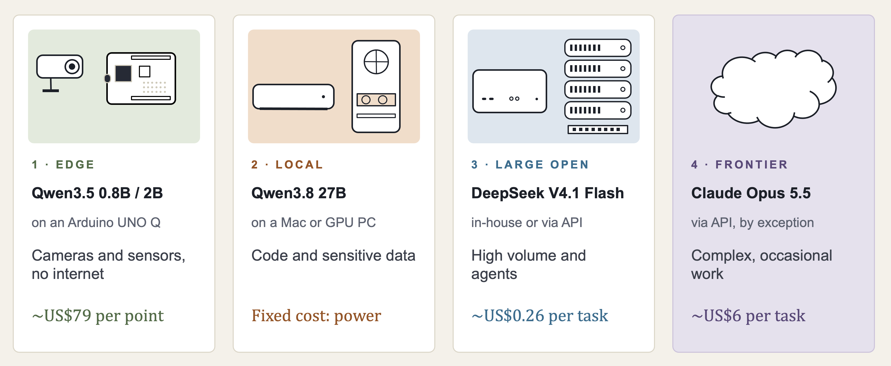

## First, the ruler changed

If you compare the numbers in this article with those in August, they will look lower. Qwen3.8 27B scored 52 on the [Artificial Analysis Intelligence Index](https://artificialanalysis.ai/) then; it scores 34 now. GLM-5.3-Flash went from 57.5 to 42.

The models did not get worse. The index did. In August I read version 4.1.1; today it is version 4.3.2, which swapped in harder, more agentic evaluations. Claude Opus 5, which sat around 63 in August, now reads about 51 on the new scale. Same models, harder exam.

The lesson is practical: never compare index values across versions. Within one version, the picture is consistent, and it is the same picture as in August.

| Model | Type | Index v4.3.2 (Oct 2026) | Runs on |
|---|---|---|---|
| Claude Opus 4.6 | closed, frontier in Feb 2026 | 32 | vendor API only |
| Qwen3.8 27B | open, dense | 34 | a 32 GB Mac |
| Claude Opus 4.8 | closed, frontier in Jun 2026 | 42 | vendor API only |
| GLM-5.3-Flash | open, MoE | 42 | a 256 GB Mac Studio |
| DeepSeek V4.1 Flash 1017 | open, MoE, MIT license | 45 | a 512 GB Mac Studio or 4× DGX Spark |
| MiMo-V2.6-Pro | open, MoE | 46 | a cluster |
| Claude Opus 5.5 | closed, frontier today | 58 | vendor API only |

Open models still trail the frontier by roughly three to four months. What was the best model in the world in February now runs on a USD 1,299 Mac mini.

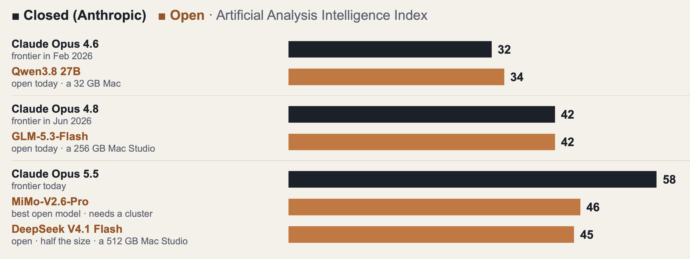

## What arrived: DeepSeek V4.1 Flash 1017

The most important release since August is a checkpoint, not a new model. On 17 October, DeepSeek replaced all 48 weight shards of V4.1 Flash. Architecture, tokenizer, and parameter count are unchanged; behavior is not. On the independent index it now scores 45, second among 121 large open-weight models, at about USD 0.26 per task and about 209 tokens per second on DeepSeek's API. It ships under the MIT license, which matters as much as the score: you can run, modify, fine-tune, and embed it without asking anyone.

Two caveats from the same evaluation. On broad business work (finance, legal, strategy, engineering, economics) it sits mid-pack, 12 to 17 points behind Claude Opus 5.5 in every domain. And it is still verbose: it used about 210 million output tokens to run the full index, against a median of 140 million. Verbosity costs cents on an API and minutes at home.

In August I wrote that the 512 GB Mac Studio had "lost its reason to exist." That was premature. DeepSeek V4.1 Flash is the model the 512 GB configuration was waiting for. And it is also the model that showed me where my August framing broke down.

## Why a "16B-active" model needs half a terabyte

DeepSeek V4.1 Flash is a mixture-of-experts model. Each token goes through 6 of 384 experts per layer, about 16 billion active parameters. The next token picks different experts, so all of them must stay loaded. The backbone is 552 billion parameters, plus a 196-billion-parameter Engram lookup table that can live on a fast NVMe SSD because it is read a few rows at a time.

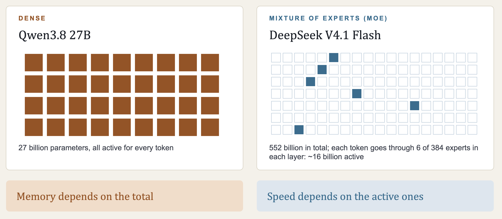

The official download is about 510 GB, and here is a detail most cost estimates miss: the experts already ship in 4-bit MXFP4 and most dense weights in 8-bit MXFP8. The usual trick of quantizing everything to Q4 saves almost nothing, because DeepSeek already did it. In my August footprint rule (0.56 GB per billion parameters), this model would come out at about 310 GB. In practice it needs 430 to 510 GB.

One thing DeepSeek got spectacularly right is the KV cache. A standard transformer of this size would need around 800 GB of cache for a one-million-token context. DeepSeek's compressed design needs under 1 GB. Long conversations are nearly free in memory; the bill is the weights.

## The concept I underweighted in August: prefill

In August I wrote that the M5's neural accelerators matter because they fix prefill, the phase in which a model reads the prompt. I was right that it matters. I underestimated how much.

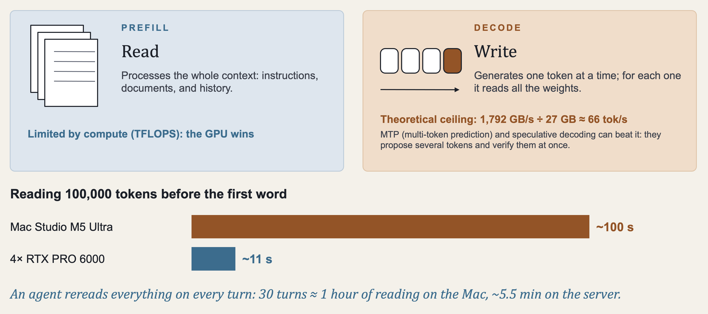

Every request has two phases:

- **Prefill** reads the whole context: system prompt, documents, history. It is limited by compute.
- **Decode** writes one token at a time, and for each token reads every weight from memory. It is limited by bandwidth. The ceiling is simple: bandwidth divided by model size. For Qwen3.8 27B at 8 bits (about 27 GB) on an RTX PRO 6000 (1,792 GB/s), that is about 66 tokens per second for one user. Multi-token prediction (MTP) and speculative decoding can beat that ceiling by proposing several tokens and verifying them in one pass, as I measured on a Raspberry Pi 5 in an earlier post.

A chat is mostly decode, which is where a Mac shines. An agent is not a chat. Every turn, it rereads its entire context. In one developer's logs from Claude Code and Codex sessions on the September build of this model, an average request read about 124,000 tokens to write 760. That is roughly 160 tokens read for every token written. An agent spends most of its life reading.

The numbers that follow come from a video comparing a Mac Studio M5 Ultra with RTX PRO 6000 servers, using MacStories' measurements and community benchmarks on similar but not identical models, so treat them as a ballpark. Reading a 100,000-token context before the first word took about **100 seconds** on the Mac and about **11 seconds** on four RTX PRO 6000 cards. Over a 30-turn coding task, that is close to an hour of reading against about five and a half minutes. The M5 really did improve prefill, roughly 2.5 times over the M3 Ultra, and a large gap remains.

Two things make this survivable:

1. **Prefix caching.** Of those 124,000 tokens, only about 2,700 were new on each turn. A good server keeps what it already read and processes only the rest. The developer who ran 111 hours of agents got a 98% cache hit rate with SGLang. With vLLM and Claude Code, a small system message that moves to the top of the prompt breaks the cache match, and the whole conversation gets reread; a fix was written but not merged when I checked.
2. **Caring about the right number.** For agents, time to first token on a long context matters more than the decode tok/s that most reviews report.

## One model, many agents: a kitchen with one chef

This is the part I got most wrong. In August I treated a machine as running *a model*. In practice it serves *agents*, and a single Claude Code session can spawn up to 20 subagents. Five people with a few subagents each is already about 15 agents asking at once.

Most people assume that if a machine writes 100 tokens per second for one agent, five agents each get 100. They don't. They share it. Think of one kitchen with one chef: a second order doesn't bring a second chef.

| Setup | One agent | Many agents |
|---|---|---|
| 2× DGX Spark | 1× | only 1.2–1.5× total throughput with 4 agents |
| 2× RTX PRO 6000 | ~100 tok/s | ~40 tok/s each with 4 agents (long contexts) |
| 4× DGX Spark (~USD 29,000) | ~50–90 tok/s | ~247 tok/s total with 16 agents, ~15 each |
| DeepSeek's API | ~209 tok/s | ~209 tok/s each |

A typical reply took about 3 seconds on the API and about 50 at home with 16 agents.

The  [video](https://www.youtube.com/watch?v=M9uRVkXuBUY&t=688s) (*Mac Studio vs NVIDIA RTX: Which AI Machine Wins?*) makes this concrete with an analogy I now use in every talk. 

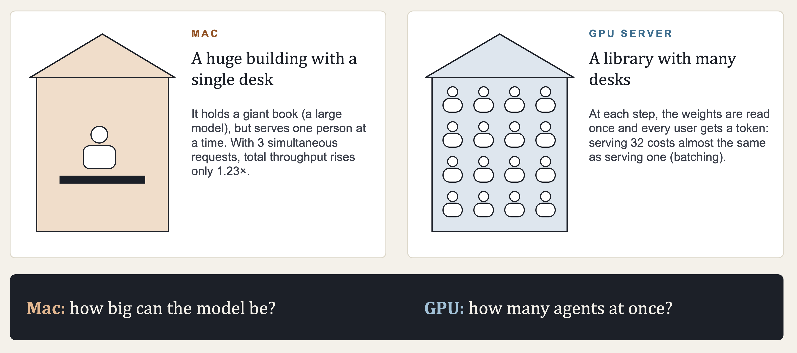

The Mac is a huge library with a single desk: it holds giant books but serves one reader at a time. The GPU server is a smaller library with many desks: at each step, the librarian brings out each book once and everyone reads from it together. That shared read is called batching, and it is why a GPU can serve 32 users for almost the same weight-reading cost as one. When MacStories ran three simultaneous requests on an M5 Ultra, total throughput rose only 1.23×.

The video's summary is the best one-line version of this whole article: **the Mac answers how big a model you can run; the GPU server answers how many agents you can run at once.**

Capacity still comes first, because you can't batch what doesn't fit. On a 96 GB RTX PRO 6000, Qwen3.8 27B at 8 bits takes about 27 GB, leaving about 59 GB for cache. At about 32 KB per token, that is 1.86 million tokens: roughly 14 agents holding 128,000-token contexts at the same time, on one card.

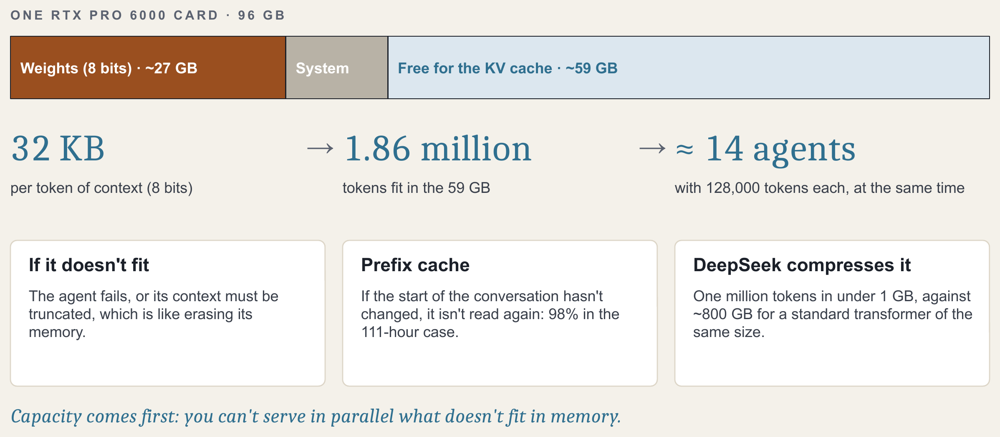

| | Mac Studio M5 Ultra, 96 GB | RTX PRO 6000, 96 GB |
|---|---|---|
| Price (US list) | USD 5,499, whole machine | USD 16,000, card only |
| Bandwidth | 1.2 TB/s | 1.79 TB/s |
| Power | ≤480 W | 300 W per card (Max-Q) |
| Read 100K tokens | ~100 s | ~11 s with 4 cards |
| Concurrent users | saturates at 2–3 | dozens, with batching |
| Best for | one person, large models, a quiet office | a team running agents and subagents |

One more hardware lesson. If you buy several GPUs, how they share the model matters. 

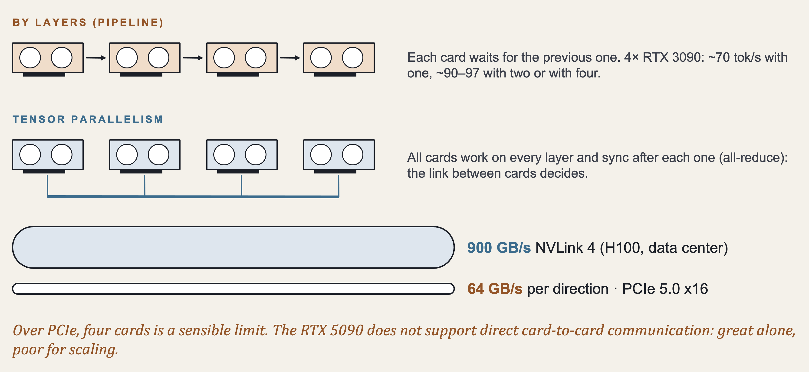

Splitting by layers turns them into a relay race: four RTX 3090s gave about 70 tok/s on one card and 90–97 on two or four. Tensor parallelism keeps all cards working but depends on the link between them: NVLink on data-center GPUs moves about 900 GB/s, PCIe 5.0 x16 about 64 GB/s in each direction. Over PCIe, four cards is a sensible limit. And the RTX 5090, which I praised in August for its bandwidth, does not support GPU-to-GPU peer-to-peer access, according to NVIDIA's own forums. It is excellent alone and a poor choice to scale.

## What it actually costs

In August I estimated that a USD 10,799 Ultra pays for itself in about fifteen months against GLM-5.2's API pricing. That math ignored prefix caching, and agents live on cache.

Here is a real workload. One developer published logs for 111 hours of coding agents running in parallel on four RTX PRO 6000 cards. His agents read about 8.7 billion tokens, about 98% of them already cached, and wrote about 53 million.

| Option | Cost of those 111 hours | Per day |
|---|---|---|
| DeepSeek's API, off-peak | ~USD 86 | ~USD 19 |
| DeepSeek's API, peak | ~USD 172 | ~USD 37 |
| Same, priced as if nothing were cached | ~USD 1,340 | |
| Claude Opus 5.5 API (my estimate from list prices) | ~USD 3,500 | ~USD 750 |

At about USD 19 a day, his USD 64,000 of cards take more than nine years to pay back, before the processor, memory, and power. The cheapest cluster that can serve 16 agents, four DGX Sparks and a switch, needs five to six years for one heavy user, and about four if a team keeps it busy around the clock. Two Sparks cost about the same as six years of Claude Max.

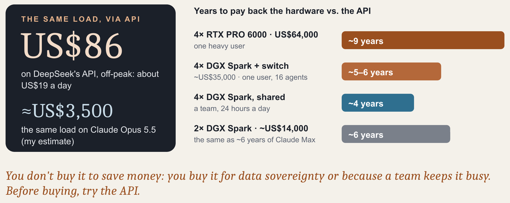

Electricity doesn't save you either. Four Sparks draw about 400 W during inference. At 48 tok/s, a million output tokens takes about 5.7 hours and 2.3 kWh: about USD 0.53 at USD 0.23/kWh, against USD 0.60 on DeepSeek's off-peak API. For a small dense model the picture is different: a 27B Qwen model on an RTX 4080 Super cost about USD 0.37 per million tokens in power against USD 3 on a hosted API.

Hardware also got more expensive since August. NVIDIA raised the DGX Spark from USD 4,699 to USD 6,950 on 2 October. RTX 5090s with a USD 1,999 list price sell from about USD 4,300. Data centers are buying memory at scale, and the bill lands on our desks.

So the honest conclusion has two halves. **You don't buy a server for a model of this size to save money.** You buy it when the data cannot leave the building, or when a team will keep it busy. And for a small model on hardware you already own, local is still an easy win.

## Via API does not mean via China

In a first draft of my talk, I treated "DeepSeek via API" as "DeepSeek's servers." That is wrong, and it matters for compliance.

Because the weights are open, anyone can serve them. On [OpenRouter,](https://openrouter.ai) on 20 October, DeepSeek V4.1 Flash 1017 was available from 20 providers: DeepSeek itself, but also Together, Baseten, Fireworks, DeepInfra, Cloudflare, Crusoe, Parasail, and others. Input prices ranged from USD 0.07 to 0.30 per million tokens and output from USD 0.18 to 1.20. Over three days, the model was available 99.93% of the time with routing across providers, against 92.45% without it. On 15 October, DeepSeek's own API was partly down for nearly five hours.

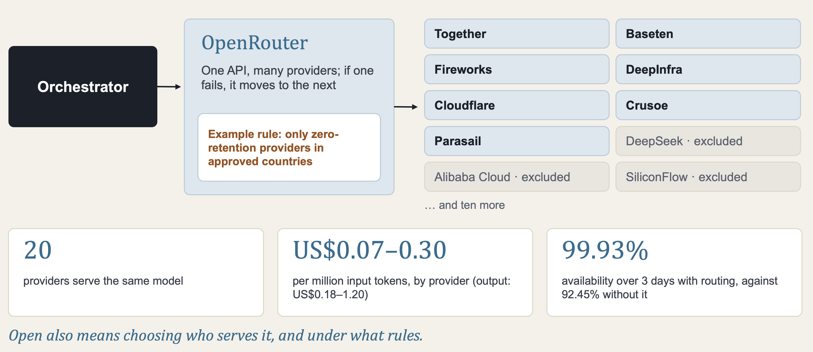

OpenRouter lets you restrict which providers receive your requests, for example only those that do not store or train on your data, or only those in approved countries. It is also an intermediary your data passes through, and each provider's policy needs checking. But the point stands: **open means choosing not only the model, but also who serves it and under what rules.** A closed model gives you one vendor. An open one gives you a market.

## A design for a hybrid system

Putting this together, here is the architecture I now recommend, and the one I walk through in the companion deck.

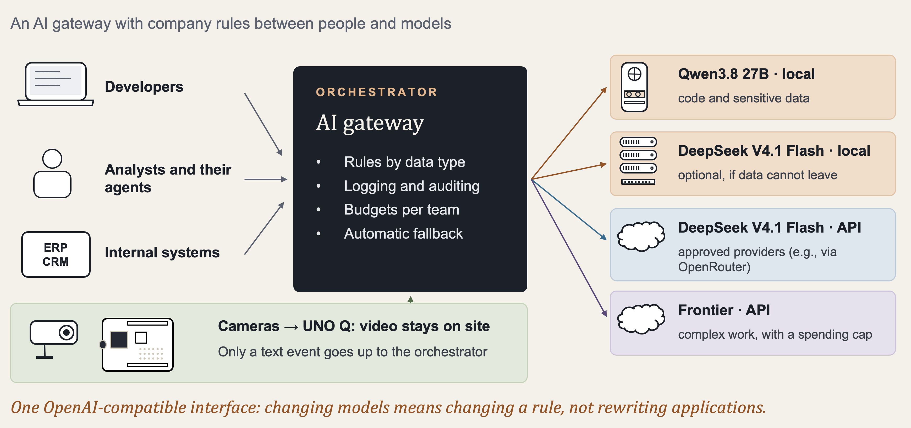

**Layer 1, edge.** An Arduino UNO-Q (USD 79, Linux plus an STM32 microcontroller, 2–4 GB of RAM) with a USB camera and Qwen3.5 0.8B or 2B. A lightweight motion detector discards almost every frame; when something changes, the model describes the frame in words, and the MCU switches on a light or a relay. It is not real-time video: analyzing an image takes the board minutes, which is why the pre-filter matters. The rule at this layer: video and raw data stay on site; only text events leave.

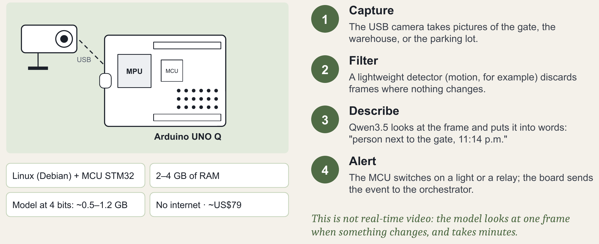

**Layer 2, local.** Qwen3.8 27B (Apache 2.0, index 34) for code and sensitive data. For one person, a 32–64 GB Mac or a PC with an RTX 5090. For a development team running agents, a server with one RTX PRO 6000, with prefix caching on. Here the model never changes without notice. That's not a small benefit: DeepSeek's old "V4 Flash" API name now routes to V4.1, which is great if you wanted the upgrade and a debugging session if your evaluations were built on the old behavior.

**Layer 3, large open model.** DeepSeek V4.1 Flash for high-volume work and agents, via API through approved providers by default, or in-house (a 512 GB Mac Studio for one agent, four DGX Sparks for a team) when the data cannot leave.

**Layer 4, frontier.** Claude Opus 5.5 or another frontier model, by exception: strategy, due diligence, hard architecture, final review of key documents. Never with confidential data, with a monthly spending cap, and with every use logged. At about USD 6 per task against USD 0.26 for DeepSeek, it earns its place only where the 13-point gap matters.

**The orchestrator.** All requests go through one AI gateway (LiteLLM or similar) that exposes a single OpenAI-compatible endpoint and routes by rules the company writes:

| If the request… | …it goes to |
|---|---|
| carries camera video or images | the edge; only the event leaves |
| carries proprietary code or confidential data | Qwen local, or DeepSeek local if it exists |
| is high-volume and non-sensitive | DeepSeek via API, approved providers only |
| is complex, occasional, and free of sensitive data | the frontier, with a spending cap |
| hits a provider that is down | the next open option |

Changing models becomes changing a rule, not rewriting applications. And the rules start from a data classification (confidential, internal, public) that legal and IT agree on before anything is installed. In Chile, where Law 21.719 on personal data is scheduled to take effect on 1 December 2026, that classification is also what you will show the new regulator.

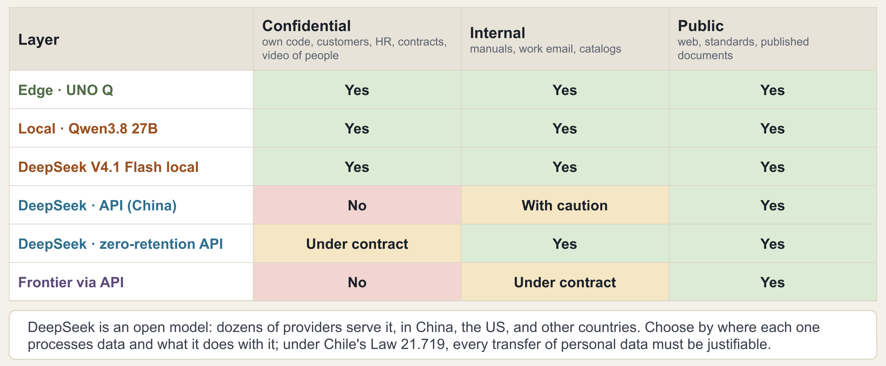

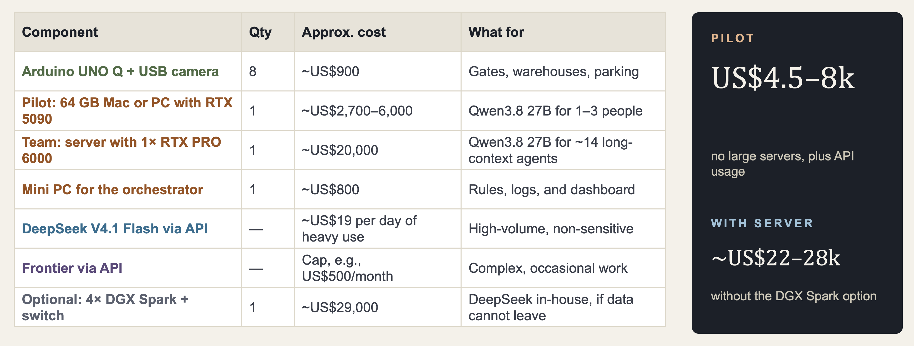

For a company of about fifty people, a pilot of this design costs roughly USD 4,500 to 8,000 in hardware (eight UNO-Q boards with cameras, one Mac or 5090 PC, and a mini PC for the gateway), plus API usage. Adding a team GPU server brings it to about USD 22,000 to 28,000. Those are US prices; elsewhere, add taxes and import costs.

## What I would actually buy now

The August list was organized by budget. This one is organized by workload, because that turned out to be what decides.

- **One person, one model, mostly chat and documents:** a 32 GB Mac mini with Qwen3.8 27B, and an API for everything else. Unchanged from August, and still the best value.
- **One person running long agent sessions:** the same Mac, but measure time to first token on your real contexts before buying a bigger one. If the wait is minutes, more memory won't fix it.
- **A team running agents in parallel on sensitive code:** a GPU server, starting with one RTX PRO 6000. Measure tokens per second with one, four, and eight agents before you buy the second card.
- **Data that cannot leave, and a model of DeepSeek's size:** a 512 GB Mac Studio if one agent at a time is enough; four DGX Sparks with SGLang and prefix caching if a team will share it.
- **Everything else:** rent. Through an approved provider, not necessarily the model's creator.

## What I'm still not sure about

The comparisons between Macs and GPU servers come from different models and different setups. They are consistent with each other and with what I see on my own machines, but they are not a controlled benchmark.

DeepSeek's claim that the new checkpoint shortens output has no number attached. If it cuts output by a third, a typical home task gets about nine minutes back, and token efficiency becomes worth more than raw speed. The first data point is encouraging: on Artificial Analysis's verbosity ranking, the September version was reported last of 47 models, and the 1017 checkpoint is 39th.

And the floor keeps moving. V4 Flash was 284 billion parameters and ran on two Sparks; six weeks later, V4.1 Flash needs four. The better model was also the heavier one. What I'm watching is not whether consumer hardware gets fast enough, but whether token efficiency improves faster than memory prices fall.

In August I ended with a USD 79 board running a tool-calling agent and a USD 10,799 desktop running a model six points off the best in the world. Both are still true. The update is that the board and the desktop are not alternatives. They are layers of the same system, and the hard part is no longer fitting the model. It is serving many agents at once, and deciding, request by request, where each one should run.

## Sources and method

- Intelligence Index, cost per task, speed, capability indexes, and verbosity: Artificial Analysis, Intelligence Index v4.3.2, read 18–20 October 2026, highest-effort variant per model. Index values are not comparable with the v4.1.1 values used in the August article.
- DeepSeek V4.1 Flash 1017 providers, prices, speeds, and availability: [OpenRouter providers page](https://openrouter.ai/deepseek/deepseek-v4.1-flash-1017/providers), 20 October 2026.
- Agent logs, the 111-hour workload, hardware throughput, and concurrency measurements: ["DeepSeek V4.1 1017 Flash Is Opus-Level: What Does It Really Cost to Run?"](https://www.youtube.com/watch?v=7He67ICRQ3M), October 2026, and the community measurements it cites.
- Hardware prices, electricity, verbosity, and model architecture: ["What Would it Cost to Run Deepseek V4.1 Flash 1017 Locally?"](https://www.youtube.com/watch?v=Y7JEvvH8Wao), October 2026.
- Prefill, batching, KV-cache capacity, multi-GPU scaling, and model pinning: ["Mac Studio vs NVIDIA RTX: Which AI Machine Wins?"](https://www.youtube.com/watch?v=M9uRVkXuBUY), October 2026, which cites MacStories measurements, community benchmarks, and NVIDIA's forums.
- Claude Opus 5.5 pricing: Anthropic's published API rates (USD 4 input, USD 20 output, USD 0.20 cache read per million tokens). The USD 3,500 figure for the 111-hour workload is my own estimate from those rates.
- The 50-person cost example uses US list prices, a USB camera estimated at about USD 30, and a host computer for the RTX PRO 6000 estimated at about USD 4,000.

Companion videos: [Open and Local AI, Part 1](https://youtu.be/TbqkBsjqWPU) and [Part 2](https://youtu.be/S-0B4Ajbj28), based on the decks "Open and local AI: no longer a sacrifice" and "Open, hybrid AI, from the camera to the frontier" (October 2026).

*This article was drafted by Claude Opus 5.5, under my direction, from my two October 2026 presentations, my August article, and the sources above. I reviewed and edited the final text.*
