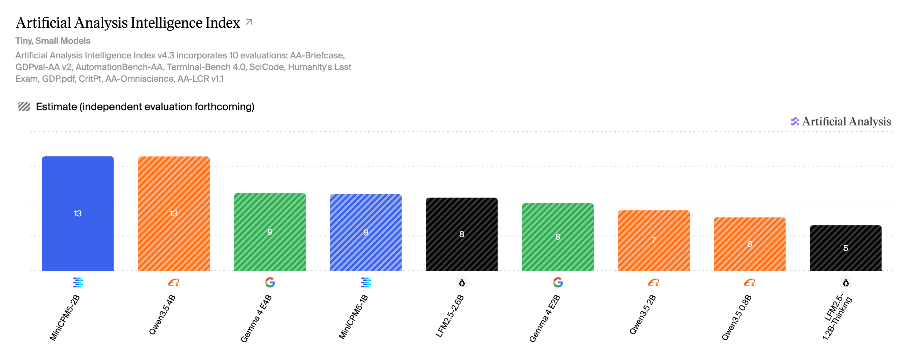
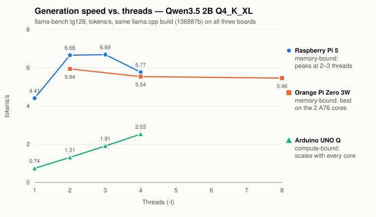
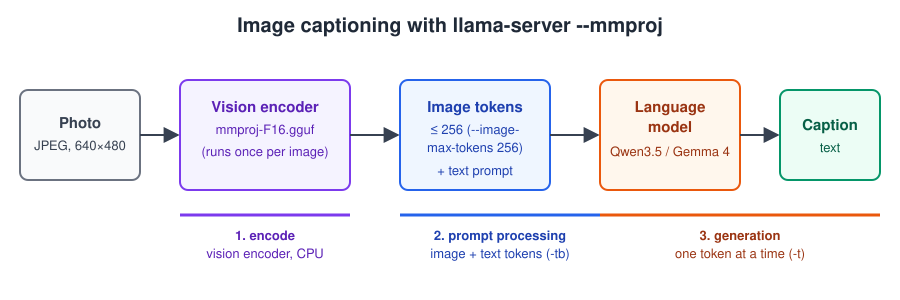
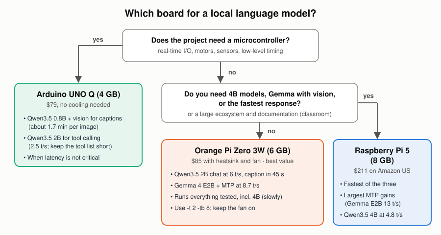

## Introduction

In an [earlier article](/articles/slm-on-raspberry-pi-mtp/), we pushed a Raspberry Pi 5 to see how close a small language model could get to the hardware's limit. The obvious next question from students and readers was: *what about the other boards?* A Raspberry Pi 5 with 8 GB now costs about $211 on Amazon US with its cooler. The new Orange Pi Zero 3W costs $85 with its heatsink and fan. The Arduino UNO Q costs $79 and adds a microcontroller to the Linux side.

This article answers that question with measurements, not spec sheets. All three boards ran **the same model files** (checked by SHA-256), **the same llama.cpp build** (`136887b`), and **the same benchmark protocol**. We measured chat, image captioning, memory, long contexts, and a tool-calling agent. The results do not produce a single winner. They produce a map: each board has a job it does well, and the limits come from different places on each one.

**Hardware:**

| Board | SoC / CPU | RAM | Cooling | Price (Amazon US, Sept. 2026) |
|---|---|---|---|---:|
| Raspberry Pi 5 | BCM2712: 4× Cortex-A76 @ 2.4 GHz | 8 GB | Active Cooler | $200.00 + $10.95 |
| Orange Pi Zero 3W | Allwinner A733: 2× Cortex-A76 @ 2.0 GHz + 6× Cortex-A55 @ 1.8 GHz | 6 GB | heatsink + fan (included) | $84.99 |
| Arduino UNO Q | Qualcomm QRB2210: 4× Cortex-A53 @ 2.0 GHz, plus an STM32U585 MCU | 4 GB | none | $79.00 |

> Every number below was measured on these boards, with repeats. Re-measure on yours: results move with the model, the thread count, and the llama.cpp build.

---

## 1. The models

We picked models that fit the smallest board and that people actually use at this size. On the [Artificial Analysis Intelligence Index v4.3](https://artificialanalysis.ai/) (tiny and small models):

| Model | Params | AA Index v4.3 | File used | Size |
|---|---|---:|---|---:|
| MiniCPM5 2B | 2B | **13** | `openbmb/MiniCPM5-2B-GGUF` Q4_K_M | 1.56 GB |
| Qwen3.5 4B | 4B | 13 (est.) | `unsloth/Qwen3.5-4B-MTP-GGUF` UD-Q4_K_XL | 2.79 GB |
| MiniCPM5 1B | 1B | 9 (est.) | `openbmb/MiniCPM5-1B-GGUF` Q4_K_M | 0.69 GB |
| Gemma 4 E2B | ~2B effective | 8 (est.) | `unsloth/gemma-4-E2B-it-qat-GGUF` UD-Q4_K_XL | 2.44 GB |
| Qwen3.5 2B | 2B | 7 (est.) | `unsloth/Qwen3.5-2B-MTP-GGUF` UD-Q4_K_XL | 1.38 GB |
| Qwen3.5 0.8B | 0.8B | 6 (est.) | `unsloth/Qwen3.5-0.8B-MTP-GGUF` UD-Q8_K_XL | 1.20 GB |

"(est.)" marks values that Artificial Analysis showed as estimates, pending independent evaluation. MiniCPM5 2B is the surprise of the list: with an independently evaluated score, it ties Qwen3.5 4B at half the size. Keep that in mind for Section 6, where its architecture matters more than its score.

---

## 2. What limits each board

Before comparing speeds, it helps to know *why* each board is as fast as it is. The quickest way to see it is to run the same model with 1, 2, 3, and more threads:

The three curves tell two different stories.

**The Raspberry Pi 5 and the Orange Pi Zero 3W are memory-bound.** Generating a token means reading every model weight once. Once two or three cores saturate the memory bus, more cores only add synchronization overhead, so speed peaks at 2–3 threads and then drops. Multiplying tokens per second by the model size gives the memory bandwidth each board really achieves: about 9–13 GB/s on the Pi 5, which matches the 9.3 GB/s measured in the earlier article, and 8–10.5 GB/s on the Orange Pi.

**The Arduino UNO Q is compute-bound.** Its speed grows almost linearly with every core added: 0.74, 1.31, 1.91, and 2.53 tokens/s. The Cortex-A53 is an in-order core without the INT8 dot-product instruction (`sdot`) that the A76 uses for quantized math. The arithmetic, not the memory, sets its pace.

**The Orange Pi Zero 3W has a twist of its own: two kinds of cores.** Its two fast A76 cores and six efficient A55 cores wait for each other at every layer. As soon as an A55 joins token generation, the A76s slow down to match it. The best setting is **`-t 2 -tb 8`**: two threads for generation, which the Linux scheduler places on the A76 cores by itself, and eight threads for prompt processing, which is compute-bound and benefits from every core. That one setting raised prompt processing by 35–60% with no loss in generation.

This distinction drives almost every result that follows, including where multi-token prediction helps.

---

## 3. What fits: 4 GB versus 6 GB

Peak memory of `llama-server` after a real request, measured on the Orange Pi with `--load-mode none` so every byte is counted once:

| Configuration | Peak memory | 4 GB board (~3 GiB free) |
|---|---:|---|
| MiniCPM5 1B, text | 0.79 GiB | ✅ |
| Qwen3.5 0.8B, text / vision | 1.30 / 1.59 GiB | ✅ |
| MiniCPM5 2B, text | 1.68 GiB | ✅ |
| Qwen3.5 2B, text / vision | 1.84 / 2.58 GiB | ✅ |
| Gemma 4 E2B, text + MTP / vision | 3.04 / 3.86 GiB | ❌ |
| Qwen3.5 4B, text + MTP / vision | 4.01 / 4.44 GiB | ❌ |

**A 4 GB board runs everything up to 2B, including vision.** Gemma 4 E2B and Qwen3.5 4B need the 6 GB Orange Pi or the 8 GB Raspberry Pi.

A word on measuring this. With llama.cpp's default mmap loading, the process looks much larger than it is: the CPU backend repacks quantized weights into an ARM-friendly layout in anonymous memory, while the original file pages also stay resident until the kernel reclaims them. The first time we measured, Qwen3.5 2B with vision appeared to need 3.4 GiB. Loading without mmap showed the real figure: 2.6 GiB.

Is 8 GB worth it on these boards? Mostly not for speed. Because generation speed is roughly bandwidth divided by model size, an 8B model that fits in 8 GB would generate at about 1.5 tokens/s on the Pi 5. The extra memory is useful for keeping several models loaded, or for very long contexts, but not for running bigger models interactively.

---

## 4. Speed: chat and captions

### Chat (llama-bench, tokens/s, best thread setting for each board)

| Model | Test | Orange Pi Zero 3W | Raspberry Pi 5 | UNO Q |
|---|---|---:|---:|---:|
| Qwen3.5 0.8B | prompt (pp512) | 65.4 | **83.7** | 6.0 |
| | generation (tg128) | 7.57 | **8.57** | 4.84 |
| Qwen3.5 2B | prompt (pp512) | 30.3 | **41.3** | 4.22 |
| | generation (tg128) | 5.94 | **6.69** | 2.53 |
| MiniCPM5 1B | prompt (pp512) | 65.9 | **104.0** | 10.1 |
| | generation (tg128) | 15.3 | **18.4** | 5.86 |
| MiniCPM5 2B | prompt (pp512) | 23.3 | **36.2** | 3.55 |
| | generation (tg128) | 6.32 | **7.24** | 2.50 |

The Raspberry Pi 5 leads the Orange Pi by 13–20% on generation and 28–58% on prompt processing. The UNO Q generates 1.8–3.1× slower than the Pi 5, and processes prompts 10–14× slower. For the Qwen3.5 2B, the UNO Q numbers (4.22 / 2.53 tokens/s) match our earlier measurements on that board almost exactly.

### Image captioning

We asked each board to describe the same photo (640×480, below) in one paragraph, with `--image-max-tokens 256` and 128 output tokens:

| Model | Orange Pi Zero 3W | Raspberry Pi 5 | UNO Q |
|---|---:|---:|---:|
| Qwen3.5 0.8B | 22 s | **19 s** | 102 s |
| Gemma 4 E2B | 33 s | **28 s** | does not fit |
| Qwen3.5 2B | 45 s | **39 s** | 284 s |
| Qwen3.5 4B | 86 s | **74 s** | does not fit |

On a CPU, the vision encoder (the `mmproj` file) is the most expensive single step. On the Orange Pi, it took 60–78% of the image-and-prompt time for the 0.8B, 2B, and Gemma models. The 2B and 4B projectors are almost the same size, which is why their encoder time is almost the same: only the language-model part grows with the model.

---

## 5. Multi-token prediction: memory-bound boards only

Multi-token prediction (MTP) lets a small head propose the next few tokens, and the base model verifies them in one batch. The earlier article found that on the Pi 5 it pays off only when the verify batch (the draft depth n plus one) lands on a multiple of four. The three boards put that rule to a harder test. Same protocol as the article: "Explain photosynthesis in 300 words.", 256 tokens, 3 runs:

| Model | Board | No MTP | Best MTP | Gain |
|---|---|---:|---:|---:|
| Gemma 4 E2B | Raspberry Pi 5* | 9.03 | 13.06 (n=2) | **+45%** |
| | Orange Pi Zero 3W | 6.99 | 8.73 (n=3) | **+25%** |
| Qwen3.5 4B | Raspberry Pi 5* | 3.12 | 4.83 (n=3) | **+55%** |
| | Orange Pi Zero 3W | 2.70 | 3.45 (n=3) | **+28%** |
| Qwen3.5 2B | Raspberry Pi 5 | 6.62 | 8.06 (n=3) | **+22%** |
| | Orange Pi Zero 3W | 5.98 | 5.98 (n=3) | 0% |
| | UNO Q | 1.31 | 0.98 (n=1) | −25% |
| Qwen3.5 0.8B | Raspberry Pi 5 / Orange Pi | 8.04 / 7.44 | 8.42 / 7.66 | within noise |
| | UNO Q | 4.70 | 3.55 (n=1) | −24% |

\* From the earlier article (llama.cpp `91d2fc387`), same protocol.

Three things stand out:

- **On the Orange Pi, n=3 is the only draft depth that pays off, for every model.** Even Gemma, whose best setting on the Pi 5 is n=2, is *slower* than plain decoding at n=2 on the Orange Pi (5.2 vs. 7.0 tokens/s). The multiple-of-four rule holds, and on this chip it is stricter.
- **Draft acceptance depends on the model, not on the board.** Qwen3.5 4B at n=3 accepted an average of 2.98 tokens per cycle on the Orange Pi and 2.92 on the Pi 5. The difference in gain comes from how much the four-token verify step costs on each CPU.
- **On the compute-bound UNO Q, MTP always loses.** Verifying several tokens costs almost as much as generating them one by one, so the drafting work is pure overhead.

> **Rule of thumb:** try MTP on memory-bound boards, with models of 2B and up, at n=3. Skip it on the UNO Q and for sub-1B models.

---

## 6. Long contexts and agents

Chat benchmarks start from an empty context. Agents do not: a system prompt with tool definitions easily reaches thousands of tokens, and every tool result adds more. Two costs grow with the context.

**Memory.** The KV cache grows with every token in the context, and how fast depends on the architecture:

| Model | Architecture | KV cache per token | At 32K tokens |
|---|---|---:|---:|
| Gemma 4 E2B | sliding window + shared KV | 6 KiB | 192 MiB |
| Qwen3.5 2B | hybrid: attention in 6 of 25 layers | 12 KiB | 384 MiB |
| MiniCPM5 2B | full attention in all 42 layers | 42 KiB | 1.3 GiB |

**Speed.** Generation slows down as the context fills. On the Orange Pi (tokens/s):

| Model | Empty context | 4K tokens | 16K tokens |
|---|---:|---:|---:|
| Gemma 4 E2B | 7.20 | 5.02 | 2.84 |
| Qwen3.5 2B | 5.90 | 4.50 | 2.62 |
| MiniCPM5 2B | 6.33 | **2.22** | **0.74** |

This is where MiniCPM5 2B's architecture catches up with it. It has the highest benchmark score of the models tested, and with a short context, it generates faster than Qwen3.5 2B. But with full attention in every layer, its speed collapses as the context grows: at 4K tokens, it already generates less than half as fast as Qwen3.5 2B. **For agents and long conversations, Qwen3.5 (hybrid) and Gemma 4 (sliding window) hold up far better.** For short, self-contained prompts, MiniCPM5 2B is an excellent choice.

**The first turn is the expensive one.** We ran a three-turn agent with 24 tool definitions (about 4,000 tokens) on the Orange Pi:

| Model | First turn | Each following turn |
|---|---:|---:|
| Gemma 4 E2B | 2.3–3.0 min | 8 s |
| Qwen3.5 2B | 2.6 min | 12 s |
| MiniCPM5 2B | 4.0 min | 17–26 s |
| Qwen3.5 4B | 7.1 min | 17–33 s |

`llama-server`'s prompt cache works out of the box, even with the hybrid and sliding-window models. From the second turn on, only the 40–80 new tokens are processed. Two practical consequences: **keep the server running**, so the long system prompt is processed once, and **keep tool definitions short**, because every token in them costs time on the first turn.

---

## 7. Price and value

| Board | Total with cooling | Qwen3.5 2B generation | 2B caption | Runs |
|---|---:|---:|---:|---|
| Raspberry Pi 5 8 GB | $210.95 | 6.7 t/s | 39 s | everything tested |
| Raspberry Pi 5 4 GB | $137.44 | 6.7 t/s† | 39 s† | up to 2B, including vision |
| **Orange Pi Zero 3W 6 GB** | **$84.99** | **5.9 t/s** | **45 s** | **everything tested** |
| Orange Pi Zero 3W 4 GB | $73.99 | 5.9 t/s† | 45 s† | up to 2B, including vision |
| Arduino UNO Q 4 GB | $79.00 | 2.5 t/s | 284 s | up to 2B, including vision |

† Not tested; assumed equal to the larger-memory version, since the SoC and memory type are the same.

Amazon US prices, checked in September 2026. The Orange Pi Zero 3W delivers about 89% of the Pi 5's generation speed at 40% of the price of the 8 GB Pi 5 with its cooler, and the 6 GB version is the cheapest board that runs every model we tested.

---

## 8. Where to use each board

### Arduino UNO Q: when the project needs a microcontroller, and time is not critical

The UNO Q is the only one of the three with a microcontroller (an STM32) next to the Linux side. That makes it the natural choice when a language model must live next to motors, sensors, or real-time I/O. It is slow, but it runs every model up to 2B, and it did so without a heatsink and without throttling. The approach we explored in the [Generative AI at the Edge](https://mjrovai.github.io/genai-uno-q/) book for the UNO Q works well:

- **Use Qwen3.5 0.8B with vision for captions and scene descriptions.** About 1.5–2 minutes per image is fine for a camera trap, an inspection log, or a periodic "what do you see?" report.
- **Use Qwen3.5 2B for agentic functions.** In the book's [agent chapter](https://mjrovai.github.io/genai-uno-q/content/agenticai/agenticai.html), the 0.8B model hit a wall on multi-step tool use, and the 2B model got it right, at about 4× the latency. At 2.5 tokens/s, a short answer takes 10–20 seconds.
- **Keep the tool list short.** The UNO Q processes prompts at about 4 tokens/s, so a 1,000-token tool definition takes roughly 4 minutes on the first turn (estimated from the measured prompt speed). After that, the prompt cache keeps each turn short.
- **Do not use it for long free-form chat or interactive captioning.** Those tasks need the other two boards.

### Orange Pi Zero 3W: the best value for a local assistant or an embedded agent

At $85 with cooling, it delivers most of a Raspberry Pi 5's speed and runs every model we tested. It is the board to choose when cost and size matter and the model is up to 2B for interactive use:

- Qwen3.5 2B chat at 6 tokens/s, and a photo caption in about 45 seconds.
- Gemma 4 E2B with MTP (n=3) at 8.7 tokens/s: the fastest capable option on this board.
- Qwen3.5 4B fits and runs at 2.7–3.5 tokens/s: fine for short answers and background jobs.
- Always use `-t 2 -tb 8`, keep the fan on (it ran at 80–86 °C under load), and let the first boot finish before cutting power.
- The [companion tutorial](https://github.com/Mjrovai/EdgeML-with-Raspberry-Pi/tree/main/OrangePi_Zero_3W) covers the headless setup, the llama.cpp build, and the first chat and caption tests, step by step.

### Raspberry Pi 5 (8 GB): the fastest, with the richest ecosystem

The Pi 5 is the board for the largest models, the fastest responses, and the biggest MTP gains: Gemma 4 E2B at 13 tokens/s and Qwen3.5 4B at 4.8 tokens/s. Its documentation, accessories, and community also make it the easiest board for a classroom. The 4 GB version keeps the speed but has the same model limit as the UNO Q, up to 2B, and at Amazon prices it costs more than the 6 GB Orange Pi.

---

## 9. How this was measured

- **Same software everywhere.** llama.cpp commit `136887b`, built from source on each board. The Pi 5 build used a separate directory, so the earlier article's build (`91d2fc387`) stayed untouched. The Pi 5 results for Gemma 4 E2B and Qwen3.5 4B come from that article.
- **Same model files everywhere.** Checked by SHA-256 where the files were already on the board.
- **Raw throughput:** `llama-bench -p 512 -n 128 -r 3`, sweeping the thread count on each board.
- **Server protocol:** `llama-server --ctx-size 8192 --parallel 1 --flash-attn on --reasoning off`, and `/completion` with "Explain photosynthesis in 300 words.", 256 tokens, `cache_prompt: false`, and 3 runs. Sampling followed each model's recommended settings. MiniCPM5 needed `ignore_eos`, because a raw prompt without its chat template sometimes stopped after one token.
- **Thermals:**
  - Pi 5: `vcgencmd get_throttled` returned `0x0` on every run.
  - Orange Pi: stayed below its 90 °C trip point, with the CPU cooling devices at state 0.
  - UNO Q: its busy-core clock was sampled every second during each run and never left 2016 MHz.
- **Not tested:** the 4 GB versions of the Pi 5 and the Orange Pi; Gemma 4 E2B and Qwen3.5 4B on the UNO Q (they do not fit); and the full Qwen3.5 2B MTP sweep on the UNO Q, which was stopped after the 0.8B sweep showed that MTP only slows that board down.

The raw data (JSON lines for every run, including the generated captions), the benchmark scripts, and the full results table are in the [benchmarks folder](https://github.com/Mjrovai/EdgeML-with-Raspberry-Pi/tree/main/OrangePi_Zero_3W/benchmarks) of the EdgeML-with-Raspberry-Pi repository. The step-by-step Orange Pi setup is the [companion tutorial](https://github.com/Mjrovai/EdgeML-with-Raspberry-Pi/tree/main/OrangePi_Zero_3W).

---

## 10. Takeaways

1. **Know what limits your board.** The Pi 5 and the Orange Pi are memory-bound, so two or three generation threads are enough. The UNO Q is compute-bound, so it needs every core.
2. **On the Orange Pi Zero 3W, use `-t 2 -tb 8`.** Mixed big and little cores need different thread counts for generation and prompt processing.
3. **4 GB runs up to 2B, including vision.** Gemma 4 E2B and Qwen3.5 4B need 6 GB or more. 8 GB buys room for more models, not speed.
4. **MTP helps only on memory-bound boards, at n=3, with models of 2B and up.** On the UNO Q, it always slows things down.
5. **For agents, architecture beats benchmark score.** Hybrid (Qwen3.5) and sliding-window (Gemma 4) models keep their speed as the context grows. Full-attention models like MiniCPM5 do not.
6. **The first turn of an agent is the expensive one.** Keep the server running and the tool list short.
7. **Pick the board for the job.** Use the UNO Q when a microcontroller matters and time does not, the Orange Pi Zero 3W for the best value, and the Raspberry Pi 5 for the most speed and the richest ecosystem.

---

## Resources

- [Running Small Language Models on a Raspberry Pi 5](/articles/slm-on-raspberry-pi-mtp/)
- [Small Language Models on the Orange Pi Zero 3W: headless setup, llama.cpp, chat, and image captioning (tutorial)](https://github.com/Mjrovai/EdgeML-with-Raspberry-Pi/tree/main/OrangePi_Zero_3W)
- [Benchmark data and scripts](https://github.com/Mjrovai/EdgeML-with-Raspberry-Pi/tree/main/OrangePi_Zero_3W/benchmarks)
- [Generative AI at the Edge](https://mjrovai.github.io/genai-uno-q/) (Arduino UNO Q book)
- [llama.cpp](https://github.com/ggml-org/llama.cpp)
- [Artificial Analysis](https://artificialanalysis.ai/)
- Models:
  - [unsloth/Qwen3.5-0.8B-MTP-GGUF](https://huggingface.co/unsloth/Qwen3.5-0.8B-MTP-GGUF)
  - [unsloth/Qwen3.5-2B-MTP-GGUF](https://huggingface.co/unsloth/Qwen3.5-2B-MTP-GGUF)
  - [unsloth/Qwen3.5-4B-MTP-GGUF](https://huggingface.co/unsloth/Qwen3.5-4B-MTP-GGUF)
  - [unsloth/gemma-4-E2B-it-qat-GGUF](https://huggingface.co/unsloth/gemma-4-E2B-it-qat-GGUF)
  - [openbmb/MiniCPM5-1B-GGUF](https://huggingface.co/openbmb/MiniCPM5-1B-GGUF)
  - [openbmb/MiniCPM5-2B-GGUF](https://huggingface.co/openbmb/MiniCPM5-2B-GGUF)
- [Orange Pi Zero 3W](http://www.orangepi.org/html/hardWare/computerAndMicrocontrollers/service-and-support/Orange-Pi-Zero-3W.html)
- [Arduino UNO Q](https://www.arduino.cc/product-uno-q/)

---

*The benchmarks, figures, and first draft of this article were generated by Claude Opus 5.5 (Anthropic) under the author's direction.*
