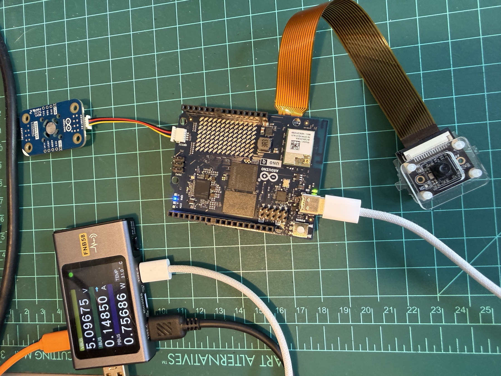
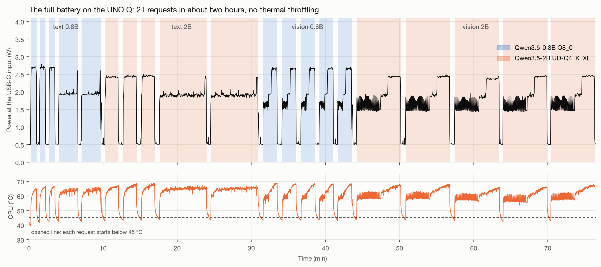
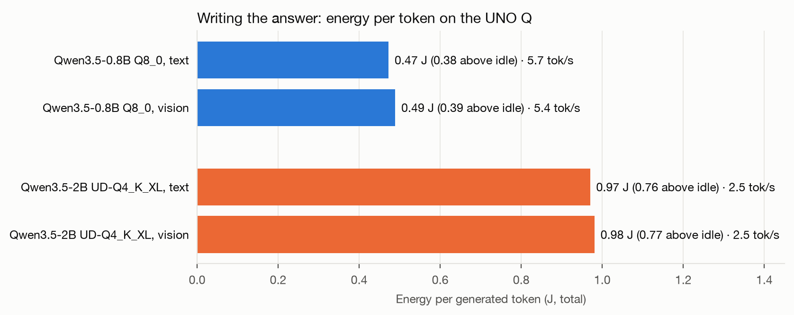
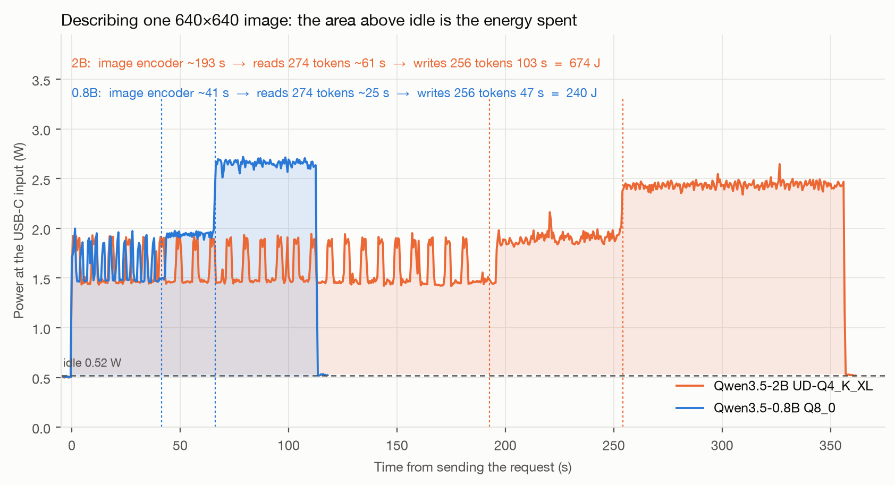
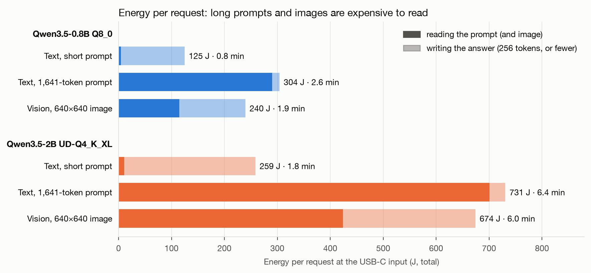

When people ask whether a board can "run AI," they usually mean speed: how many tokens per second, how long until the first word. On a device that may live on a battery or a small solar panel, a second question matters just as much: how much energy does each answer cost?

I measured that on the Arduino UNO Q (4 GB), running the same models and commands I use in my book *Generative AI at the Edge*: Qwen3.5-0.8B and Qwen3.5-2B on llama.cpp, answering text prompts and describing images. The short version: the whole board never drew more than 3.5 W, a text answer costs about 0.5 J per token with the small model, and describing one image costs about 240 J. The details are more interesting than the summary, because the power line shows exactly where the energy goes.

## The Setup

The UNO Q pairs a Qualcomm QRB2210 (four Cortex-A53 cores at 2.0 GHz, running Debian) with an STM32U585 microcontroller. This board has no NPU, so the language models run on the CPU with llama.cpp. I used the board as-is, with no heatsink or fan.

- **Models:** Qwen3.5-0.8B (Q8_0, 835 MB) and Qwen3.5-2B (Unsloth's UD-Q4_K_XL, 1.34 GB). For images, each model loads its matching F16 vision projector (205 MB and 668 MB).
- **Runtime:** llama.cpp, CPU build, `llama-server` with 4 threads, a 4096-token context, thinking turned off, and `--image-max-tokens 256` for the vision runs.
- **Meter:** a [FNIRSI FNB58](https://www.fnirsi.com/products/fnb58) USB meter between the charger and the board's USB-C port, sending 100 samples per second to a Mac. It reports the power of the whole board: SoC, memory, Wi-Fi, regulators, and everything attached.
- **Workloads:** a short text prompt (256 tokens out), a long one (1,641 tokens in), and two 640×640 photos to describe. Each model ran each prompt or image twice, after a warm-up request that was not counted.

A script on the board did the bookkeeping. Before each request it waited for the CPU to cool below 45 °C, recorded 15 seconds of idle, and then wrote down when the request was sent, when the first token arrived, and when the answer ended. Both machines keep their clocks in sync over the network, so those timestamps line up with the meter log, and the average power in each window times its duration gives the energy of each phase.

I used the same method to compare the CPU, GPU, and NPU of a [Qualcomm Dragonwing IQ-9075](https://github.com/Mjrovai/Qualcomm-IQ-9075), scaled down to a board that lives on USB-C.

## Two Hours in One Picture

The whole battery, 21 requests, took about 75 minutes:

A few things are visible before looking at any single request:

- **Idle is 0.5 W.** That includes Wi-Fi, a Modulino Thermo, and an idle expansion carrier.
- **Working, the board draws 1.5 to 2.7 W,** with short peaks to 3.5 W. A phone charger is overkill.
- **No thermal throttling.** The CPU peaked at 68.7 °C, and all four cores stayed at 2.0 GHz through every request, including the six-minute ones.
- **The two runs of each case agreed within 1%.** On a CPU with nothing else running, these measurements are very repeatable.

## Text: What a Token Costs

| | Qwen3.5-0.8B Q8_0 | Qwen3.5-2B UD-Q4_K_XL |
|---|---|---|
| Power while reading the prompt | 1.9 W | 1.9 W |
| Power while generating | 2.7 W | 2.4 W |
| Generation speed | 5.7 tok/s | 2.5 tok/s |
| **Energy per generated token** | **0.47 J** | **0.97 J** |
| Short prompt, 256-token answer | 47 s, 125 J | 108 s, 259 J |
| Reading a 1,641-token prompt | 149 s, 290 J | 368 s, 700 J |

The surprise is in the power column. The 2B model draws *less* power than the 0.8B while generating, yet it costs twice as much energy per token. It isn't hungrier; it is slower. Generation on a CPU like this is limited largely by how fast the weights can be read from memory, so four cores sit busy for twice as long per token. On this class of board, energy per token follows speed almost exactly.

The other surprise is how expensive a long prompt is. Reading 1,641 tokens costs the 0.8B about 290 J, more than writing 600 tokens would. On the 2B, it takes six minutes. If you are building a RAG pipeline or a long system prompt on a board like this, every token of context has a price in joules, not just in seconds.

## Vision: What a Description Costs

Describing an image looks like one long wait for the first token. The power line shows it is really three different jobs:

1. **The image encoder** (the spiky part, 1.5 to 1.9 W). The vision tower turns the picture into 256 image tokens. The power jumps up and down because this stage doesn't keep all four cores busy. `llama-server` doesn't log this phase on its own, so I estimated its length as the time to first token minus the time the language model needs to read the same number of tokens as text: about 41 s on the 0.8B and 193 s on the 2B.
2. **The language model reads the prompt** (flat, about 1.9 W): 274 tokens, about 25 s on the 0.8B and 61 s on the 2B.
3. **The answer** (flat, 2.4 to 2.7 W): 256 tokens in 47 s on the 0.8B and 103 s on the 2B.

| Per image | Qwen3.5-0.8B | Qwen3.5-2B |
|---|---|---|
| Image + prompt (time to first token) | 66 s, 115 J | 254 s, 424 J |
| Answer, 256 tokens | 47 s, 125 J | 103 s, 250 J |
| **Whole request** | **1.9 min, 240 J** | **6 min, 674 J** |

Two lessons come out of this chart. First, **reading the image is about half of the bill.** Asking for shorter answers helps less than you'd expect; sending fewer image tokens (`--image-max-tokens`) or a smaller image helps more. Second, **the 2B costs 2.8 times the energy of the 0.8B per image,** again while drawing slightly less power. Its vision encoder is bigger, and that one stage takes more than three minutes.

## In Battery Terms

A 10 Wh power bank holds 36,000 J. If the board did nothing else, that would cover:

| | Qwen3.5-0.8B | Qwen3.5-2B |
|---|---|---|
| Short text answers (256 tokens) | ~290 | ~140 |
| Image descriptions (256 tokens) | ~150 | ~50 |

Real deployments spend most of their time waiting, and waiting isn't free: the idle 0.5 W is about 30 J per minute, or about 44 kJ per day, more than the whole power bank. For a battery-powered camera that describes a few images per hour, the idle power matters more than the model. The practical design is to keep `llama-server` stopped (or the board asleep) and start it when there is something to look at, which on this board takes a few seconds for the 0.8B.

## A Note on the Meter

If you use an FNB58 with macOS, one detail may save you an afternoon. The open-source logging protocol sends three start commands to the meter. Sent back to back, they froze my meter (and its display) on macOS 27, even on the first session after power-up. Reading the meter's reply after each command fixed it, and the logger then worked for several sessions in a row without a power cycle. The protocol itself was decoded by the [fnirsi-usb-power-data-logger](https://github.com/baryluk/fnirsi-usb-power-data-logger) project.

## Where to Go From Here

These measurements are now part of my open book **[Generative AI at the Edge](https://mjrovai.github.io/genai-uno-q/)**, which builds everything shown here step by step on the Arduino UNO Q: compiling llama.cpp, running the models from the terminal and from Python, adding vision, and wiring the result to sensors and actuators through the microcontroller. The two sections with these numbers are:

- [What a Token Costs in Energy](https://mjrovai.github.io/genai-uno-q/content/genai/genai.html#what-a-token-costs-in-energy) (Chapter 2, text)
- [What a Description Costs: Time and Energy](https://mjrovai.github.io/genai-uno-q/content/multimodai/multimodai.html#what-a-description-costs-time-and-energy) (Chapter 3, vision)

The book is free to read online and as a PDF. If you want to see what a dedicated NPU can do, my [IQ-9075 tests](https://github.com/Mjrovai/Qualcomm-IQ-9075), measured the same way, show the other end of the scale.

*The draft of this article, the benchmark scripts, and the charts were generated with Claude Opus 5.5 (Anthropic), under the author's direction. The measurements were taken on my bench on October 29, 2026.*
